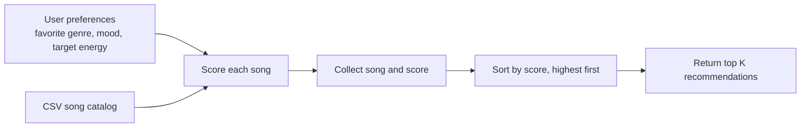

# 🎵 Music Recommender Simulation

## Project Summary

In this project you will build and explain a small music recommender system.

Your goal is to:

- Represent songs and a user "taste profile" as data
- Design a scoring rule that turns that data into recommendations
- Evaluate what your system gets right and wrong
- Reflect on how this mirrors real world AI recommenders

Replace this paragraph with your own summary of what your version does.

---

## How The System Works

This project uses content-based filtering: it compares each song's catalog
features with the user's stated preferences. The user profile contains
`favorite_genre`, `favorite_mood`, and `target_energy`; each song provides
`genre`, `mood`, and `energy` (on a 0.0–1.0 scale).

The recommendation plan is:

1. Load the song catalog from `data/songs.csv` and read the user's profile.
2. Score every song independently. Add 2 points for an exact genre match and
   1 point for an exact mood match. Add up to 1 energy point using
   `max(0, 1 - abs(song energy - target energy))`.
3. Add the points for a total score from 0 to 4, keeping the feature
   contributions as an explanation.
4. Sort songs by score, highest first, and return the first `k` recommendations.

Genre and mood matches are exact and case-insensitive; related labels do not
currently receive partial credit. The system uses only these three features,
so its results depend on the catalog labels and energy values.

**Potential bias:** Genre can contribute twice as much as mood or a perfect
energy match, so the ranking may favor a genre match over a song that better
matches the user's mood or energy. Exact label matching can also miss related
genres and moods, and the small catalog may underrepresent many musical styles.



---

## Getting Started

### Setup

1. Create a virtual environment (optional but recommended):

   ```bash
   python -m venv .venv
   source .venv/bin/activate      # Mac or Linux
   .venv\Scripts\activate         # Windows

2. Install dependencies

```bash
pip install -r requirements.txt
```

3. Run the app:

```bash
python -m src.main
```

### Running Tests

Run the starter tests with:

```bash
pytest
```

You can add more tests in `tests/test_recommender.py`.

---

## Sample Recommendation Output

```
Loaded songs: 18

Top recommendations for High-Energy Pop (pop / intense, target energy: 0.93):

1. Gym Hero - Score: 4.00/4
   Reasons: Genre matches pop (+2.0/2); Mood matches intense (+1.0/1); Energy is 0.00 from your target (+1.00/1)

2. Sunrise City - Score: 2.89/4
   Reasons: Genre matches pop (+2.0/2); Mood does not match intense (+0.0/1); Energy is 0.11 from your target (+0.89/1)

3. Storm Runner - Score: 1.98/4
   Reasons: Genre does not match pop (+0.0/2); Mood matches intense (+1.0/1); Energy is 0.02 from your target (+0.98/1)

4. Voltage Bloom - Score: 0.97/4
   Reasons: Genre does not match pop (+0.0/2); Mood does not match intense (+0.0/1); Energy is 0.03 from your target (+0.97/1)

5. Velvet Groove - Score: 0.85/4
   Reasons: Genre does not match pop (+0.0/2); Mood does not match intense (+0.0/1); Energy is 0.15 from your target (+0.85/1)

Top recommendations for Chill Lofi (lofi / chill, target energy: 0.40):

1. Midnight Coding - Score: 3.98/4
   Reasons: Genre matches lofi (+2.0/2); Mood matches chill (+1.0/1); Energy is 0.02 from your target (+0.98/1)

2. Library Rain - Score: 3.95/4
   Reasons: Genre matches lofi (+2.0/2); Mood matches chill (+1.0/1); Energy is 0.05 from your target (+0.95/1)

3. Focus Flow - Score: 3.00/4
   Reasons: Genre matches lofi (+2.0/2); Mood does not match chill (+0.0/1); Energy is 0.00 from your target (+1.00/1)

4. Spacewalk Thoughts - Score: 1.88/4
   Reasons: Genre does not match lofi (+0.0/2); Mood matches chill (+1.0/1); Energy is 0.12 from your target (+0.88/1)

5. Coffee Shop Stories - Score: 0.97/4
   Reasons: Genre does not match lofi (+0.0/2); Mood does not match chill (+0.0/1); Energy is 0.03 from your target (+0.97/1)

Top recommendations for Deep Intense Rock (rock / intense, target energy: 0.91):

1. Storm Runner - Score: 4.00/4
   Reasons: Genre matches rock (+2.0/2); Mood matches intense (+1.0/1); Energy is 0.00 from your target (+1.00/1)

2. Gym Hero - Score: 1.98/4
   Reasons: Genre does not match rock (+0.0/2); Mood matches intense (+1.0/1); Energy is 0.02 from your target (+0.98/1)

3. Voltage Bloom - Score: 0.95/4
   Reasons: Genre does not match rock (+0.0/2); Mood does not match intense (+0.0/1); Energy is 0.05 from your target (+0.95/1)

4. Sunrise City - Score: 0.91/4
   Reasons: Genre does not match rock (+0.0/2); Mood does not match intense (+0.0/1); Energy is 0.09 from your target (+0.91/1)

5. Velvet Groove - Score: 0.87/4
   Reasons: Genre does not match rock (+0.0/2); Mood does not match intense (+0.0/1); Energy is 0.13 from your target (+0.87/1)
```

## System Evaluation: Adversarial Profiles

These AI-suggested cases probe conflicting preferences, an energy target
outside the expected 0.0–1.0 range, and case-insensitive label matching.

**Conflicting profile: metal / melancholic / high energy**

```text
Top recommendations for Conflicting: Metal / Melancholic / High Energy (metal / melancholic, target energy: 0.96):

1. Voltage Bloom - Score: 3.00/4
   Reasons: Genre matches metal (+2.0/2); Mood does not match melancholic (+0.0/1); Energy is 0.00 from your target (+1.00/1)

2. Blue Window - Score: 1.35/4
   Reasons: Genre does not match metal (+0.0/2); Mood matches melancholic (+1.0/1); Energy is 0.65 from your target (+0.35/1)

3. Gym Hero - Score: 0.97/4
   Reasons: Genre does not match metal (+0.0/2); Mood does not match melancholic (+0.0/1); Energy is 0.03 from your target (+0.97/1)

4. Storm Runner - Score: 0.95/4
   Reasons: Genre does not match metal (+0.0/2); Mood does not match melancholic (+0.0/1); Energy is 0.05 from your target (+0.95/1)

5. Sunrise City - Score: 0.86/4
   Reasons: Genre does not match metal (+0.0/2); Mood does not match melancholic (+0.0/1); Energy is 0.14 from your target (+0.86/1)
```

**Out-of-range energy target: country / serene / 2.0**

```text
Top recommendations for Out-of-Range Energy Target (country / serene, target energy: 2.00):

1. Golden Hour Road - Score: 2.00/4
   Reasons: Genre matches country (+2.0/2); Mood does not match serene (+0.0/1); Energy is 1.42 from your target (+0.00/1)

2. Paper Moons - Score: 1.00/4
   Reasons: Genre does not match country (+0.0/2); Mood matches serene (+1.0/1); Energy is 1.78 from your target (+0.00/1)

3. Sunrise City - Score: 0.00/4
   Reasons: Genre does not match country (+0.0/2); Mood does not match serene (+0.0/1); Energy is 1.18 from your target (+0.00/1)

4. Midnight Coding - Score: 0.00/4
   Reasons: Genre does not match country (+0.0/2); Mood does not match serene (+0.0/1); Energy is 1.58 from your target (+0.00/1)

5. Storm Runner - Score: 0.00/4
   Reasons: Genre does not match country (+0.0/2); Mood does not match serene (+0.0/1); Energy is 1.09 from your target (+0.00/1)
```

All songs receive zero energy points in this case because the similarity formula
floors negative values at 0. The ties remain in catalog order. This also shows
the current scorer does not validate that target energy is within 0.0–1.0.

**Case-insensitive labels and exact energy: LoFi / CHILL / 0.40**

```text
Top recommendations for Case-Insensitive Labels / Exact Energy (LoFi / CHILL, target energy: 0.40):

1. Midnight Coding - Score: 3.98/4
   Reasons: Genre matches LoFi (+2.0/2); Mood matches CHILL (+1.0/1); Energy is 0.02 from your target (+0.98/1)

2. Library Rain - Score: 3.95/4
   Reasons: Genre matches LoFi (+2.0/2); Mood matches CHILL (+1.0/1); Energy is 0.05 from your target (+0.95/1)

3. Focus Flow - Score: 3.00/4
   Reasons: Genre matches LoFi (+2.0/2); Mood does not match CHILL (+0.0/1); Energy is 0.00 from your target (+1.00/1)

4. Spacewalk Thoughts - Score: 1.88/4
   Reasons: Genre does not match LoFi (+0.0/2); Mood matches CHILL (+1.0/1); Energy is 0.12 from your target (+0.88/1)

5. Coffee Shop Stories - Score: 0.97/4
   Reasons: Genre does not match LoFi (+0.0/2); Mood does not match CHILL (+0.0/1); Energy is 0.03 from your target (+0.97/1)
```

Case-insensitive genre/mood matching works as expected, and the exact-energy
song Focus Flow still ranks below the songs matching both categorical
preferences.

---

## Experiments You Tried

### Weight shift: less genre, more energy

To test sensitivity without changing the default results, `score_song` and
`recommend_songs` accept `weight_shift=True`. The experiment halves the genre
weight from 2 to 1 and doubles the energy weight from 1 to 2; mood remains 1.
The maximum possible score stays 4, so scores remain comparable.

For the High-Energy Pop profile, the baseline top three were Gym Hero (4.00),
Sunrise City (2.89), and Storm Runner (1.98). Under the shifted weights,
Storm Runner moves above Sunrise City because its intense mood matches and
its energy is closer, while Sunrise City loses one point of genre weight.
This demonstrates a different ranking, not necessarily a more accurate one:
the catalog contains no user judgments or listening outcomes to measure
accuracy.

```text
Weight-shift experiment for High-Energy Pop (genre 2 -> 1, energy 1 -> 2, mood stays 1):

1. Gym Hero - Score: 4.00/4
   Reasons: Genre matches pop (+1.0/1); Mood matches intense (+1.0/1); Energy is 0.00 from your target (+2.00/2)

2. Storm Runner - Score: 2.96/4
   Reasons: Genre does not match pop (+0.0/1); Mood matches intense (+1.0/1); Energy is 0.02 from your target (+1.96/2)

3. Sunrise City - Score: 2.78/4
   Reasons: Genre matches pop (+1.0/1); Mood does not match intense (+0.0/1); Energy is 0.11 from your target (+1.78/2)

4. Voltage Bloom - Score: 1.94/4
   Reasons: Genre does not match pop (+0.0/1); Mood does not match intense (+0.0/1); Energy is 0.03 from your target (+1.94/2)

5. Velvet Groove - Score: 1.70/4
   Reasons: Genre does not match pop (+0.0/1); Mood does not match intense (+0.0/1); Energy is 0.15 from your target (+1.70/2)
```

---

## Limitations and Risks

Summarize some limitations of your recommender.

Examples:

- It only works on a tiny catalog
- It does not understand lyrics or language
- It might over favor one genre or mood

You will go deeper on this in your model card.

---

## Reflection

Read and complete `model_card.md`:

[**Model Card**](model_card.md)

Write 1 to 2 paragraphs here about what you learned:

- about how recommenders turn data into predictions
- about where bias or unfairness could show up in systems like this

## Profile Ranking Results and Explanations

Scores below use the current weights: +2 for an exact genre match, +1 for an
case-insensitive mood match, and up to +1 for energy similarity. `G`, `M`, and
`E` show the points from genre, mood, and energy respectively.

### High-Energy Pop — pop / intense / target energy 0.93

| Rank | Song | Score | Why it ranked |
|---:|---|---:|---|
| 1 | Gym Hero | 4.00 | G +2, M +1, E +1.00: matches both labels and target energy exactly. |
| 2 | Sunrise City | 2.89 | G +2, M +0, E +0.89: matches pop; energy is 0.11 below target. |
| 3 | Storm Runner | 1.98 | G +0, M +1, E +0.98: matches intense; energy is 0.02 away. |
| 4 | Voltage Bloom | 0.97 | G +0, M +0, E +0.97: neither label matches; energy is 0.03 away. |
| 5 | Velvet Groove | 0.85 | G +0, M +0, E +0.85: neither label matches; energy is 0.15 away. |

### Chill Lofi — lofi / chill / target energy 0.40

| Rank | Song | Score | Why it ranked |
|---:|---|---:|---|
| 1 | Midnight Coding | 3.98 | G +2, M +1, E +0.98: matches both labels; energy is 0.02 away. |
| 2 | Library Rain | 3.95 | G +2, M +1, E +0.95: matches both labels; energy is 0.05 away. |
| 3 | Focus Flow | 3.00 | G +2, M +0, E +1.00: matches lofi and has exact target energy. |
| 4 | Spacewalk Thoughts | 1.88 | G +0, M +1, E +0.88: matches chill; energy is 0.12 away. |
| 5 | Coffee Shop Stories | 0.97 | G +0, M +0, E +0.97: neither label matches; energy is 0.03 away. |

### Deep Intense Rock — rock / intense / target energy 0.91

| Rank | Song | Score | Why it ranked |
|---:|---|---:|---|
| 1 | Storm Runner | 4.00 | G +2, M +1, E +1.00: matches both labels and target energy exactly. |
| 2 | Gym Hero | 1.98 | G +0, M +1, E +0.98: matches intense; energy is 0.02 away. |
| 3 | Voltage Bloom | 0.95 | G +0, M +0, E +0.95: neither label matches; energy is 0.05 away. |
| 4 | Sunrise City | 0.91 | G +0, M +0, E +0.91: neither label matches; energy is 0.09 away. |
| 5 | Velvet Groove | 0.87 | G +0, M +0, E +0.87: neither label matches; energy is 0.13 away. |

### Conflicting: Metal / Melancholic / High Energy — metal / melancholic / target energy 0.96

| Rank | Song | Score | Why it ranked |
|---:|---|---:|---|
| 1 | Voltage Bloom | 3.00 | G +2, M +0, E +1.00: metal match and exact energy outweigh the missed mood. |
| 2 | Blue Window | 1.35 | G +0, M +1, E +0.35: matches melancholic, but energy is 0.65 away. |
| 3 | Gym Hero | 0.97 | G +0, M +0, E +0.97: neither label matches; energy is 0.03 away. |
| 4 | Storm Runner | 0.95 | G +0, M +0, E +0.95: neither label matches; energy is 0.05 away. |
| 5 | Sunrise City | 0.86 | G +0, M +0, E +0.86: neither label matches; energy is 0.14 away. |

### Out-of-Range Energy Target — country / serene / target energy 2.00

| Rank | Song | Score | Why it ranked |
|---:|---|---:|---|
| 1 | Golden Hour Road | 2.00 | G +2, M +0, E +0: country match; energy similarity floors at zero. |
| 2 | Paper Moons | 1.00 | G +0, M +1, E +0: serene match; energy similarity floors at zero. |
| 3 | Sunrise City | 0.00 | G +0, M +0, E +0: no label matches and no energy points. |
| 4 | Midnight Coding | 0.00 | G +0, M +0, E +0: no label matches and no energy points. |
| 5 | Storm Runner | 0.00 | G +0, M +0, E +0: no label matches and no energy points. |

All songs receive zero energy points for this out-of-range target, so the final
three zero-score songs retain their catalog order.

### Case-Insensitive Labels / Exact Energy — LoFi / CHILL / target energy 0.40

| Rank | Song | Score | Why it ranked |
|---:|---|---:|---|
| 1 | Midnight Coding | 3.98 | G +2, M +1, E +0.98: case-insensitive matches on both labels; energy is 0.02 away. |
| 2 | Library Rain | 3.95 | G +2, M +1, E +0.95: matches both labels; energy is 0.05 away. |
| 3 | Focus Flow | 3.00 | G +2, M +0, E +1.00: matches lofi and has exact energy, but not chill. |
| 4 | Spacewalk Thoughts | 1.88 | G +0, M +1, E +0.88: matches chill; energy is 0.12 away. |
| 5 | Coffee Shop Stories | 0.97 | G +0, M +0, E +0.97: neither label matches; energy is 0.03 away. |

Although Focus Flow has an exact energy match, songs matching both categorical
preferences rank above it because genre and mood together contribute 3 points.
