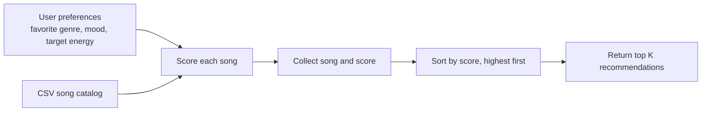

# 🎵 Music Recommender Simulation

## Project Summary

In this project you will build and explain a small music recommender system.

Your goal is to:

- Represent songs and a user "taste profile" as data
- Design a scoring rule that turns that data into recommendations
- Evaluate what your system gets right and wrong
- Reflect on how this mirrors real world AI recommenders

Replace this paragraph with your own summary of what your version does.

---

## How The System Works

This project uses content-based filtering: it compares each song's catalog
features with the user's stated preferences. The user profile contains
`favorite_genre`, `favorite_mood`, and `target_energy`; each song provides
`genre`, `mood`, and `energy` (on a 0.0–1.0 scale).

The recommendation plan is:

1. Load the song catalog from `data/songs.csv` and read the user's profile.
2. Score every song independently. Add 2 points for an exact genre match and
   1 point for an exact mood match. Add up to 1 energy point using
   `max(0, 1 - abs(song energy - target energy))`.
3. Add the points for a total score from 0 to 4, keeping the feature
   contributions as an explanation.
4. Sort songs by score, highest first, and return the first `k` recommendations.

Genre and mood matches are exact and case-insensitive; related labels do not
currently receive partial credit. The system uses only these three features,
so its results depend on the catalog labels and energy values.

**Potential bias:** Genre can contribute twice as much as mood or a perfect
energy match, so the ranking may favor a genre match over a song that better
matches the user's mood or energy. Exact label matching can also miss related
genres and moods, and the small catalog may underrepresent many musical styles.



---

## Getting Started

### Setup

1. Create a virtual environment (optional but recommended):

   ```bash
   python -m venv .venv
   source .venv/bin/activate      # Mac or Linux
   .venv\Scripts\activate         # Windows

2. Install dependencies

```bash
pip install -r requirements.txt
```

3. Run the app:

```bash
python -m src.main
```

### Running Tests

Run the starter tests with:

```bash
pytest
```

You can add more tests in `tests/test_recommender.py`.

---

## Sample Recommendation Output

Paste a sample of your recommender's output here as a text block so a reader can see what it produces:

```
# e.g.:
# User profile: genre=indie, mood=chill, energy=low
# Recommendations:
#   1. ...
#   2. ...
#   3. ...
```

**Screenshot or video** *(optional)*: <!-- Insert a screenshot or demo video link here -->

---

## Experiments You Tried

Use this section to document the experiments you ran. For example:

- What happened when you changed the weight on genre from 2.0 to 0.5
- What happened when you added tempo or valence to the score
- How did your system behave for different types of users

---

## Limitations and Risks

Summarize some limitations of your recommender.

Examples:

- It only works on a tiny catalog
- It does not understand lyrics or language
- It might over favor one genre or mood

You will go deeper on this in your model card.

---

## Reflection

Read and complete `model_card.md`:

[**Model Card**](model_card.md)

Write 1 to 2 paragraphs here about what you learned:

- about how recommenders turn data into predictions
- about where bias or unfairness could show up in systems like this
